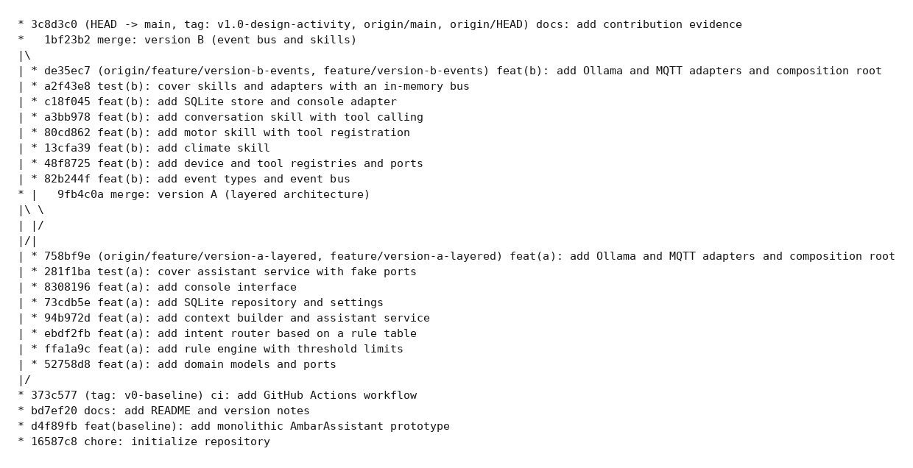
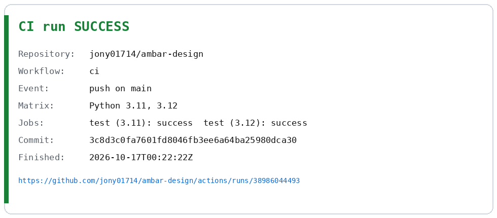

# Contribution evidence

Raw, unedited command output captured from the repository at the time of this commit.

## History graph

```console
$ git log --graph --oneline --decorate --all
*   1bf23b2 (HEAD -> main) merge: version B (event bus and skills)
|\  
| * de35ec7 (origin/feature/version-b-events, feature/version-b-events) feat(b): add Ollama and MQTT adapters and composition root
| * a2f43e8 test(b): cover skills and adapters with an in-memory bus
| * c18f045 feat(b): add SQLite store and console adapter
| * a3bb978 feat(b): add conversation skill with tool calling
| * 80cd862 feat(b): add motor skill with tool registration
| * 13cfa39 feat(b): add climate skill
| * 48f8725 feat(b): add device and tool registries and ports
| * 82b244f feat(b): add event types and event bus
* |   9fb4c0a merge: version A (layered architecture)
|\ \  
| |/  
|/|   
| * 758bf9e (origin/feature/version-a-layered, feature/version-a-layered) feat(a): add Ollama and MQTT adapters and composition root
| * 281f1ba test(a): cover assistant service with fake ports
| * 8308196 feat(a): add console interface
| * 73cdb5e feat(a): add SQLite repository and settings
| * 94b972d feat(a): add context builder and assistant service
| * ebdf2fb feat(a): add intent router based on a rule table
| * ffa1a9c feat(a): add rule engine with threshold limits
| * 52758d8 feat(a): add domain models and ports
|/  
* 373c577 (tag: v0-baseline, origin/main, origin/HEAD) ci: add GitHub Actions workflow
* bd7ef20 docs: add README and version notes
* d4f89fb feat(baseline): add monolithic AmbarAssistant prototype
* 16587c8 chore: initialize repository
```

## Commits per author

```console
$ git shortlog -sn --all
    22	Jonathan Israel Gonzalez Ruiz
```

## Commits per branch

```console
$ git rev-list --count v0-baseline..feature/version-a-layered
8
```

```console
$ git rev-list --count v0-baseline..feature/version-b-events
8
```

## Version A commits (feature/version-a-layered)

```console
$ git log --format='%h %an %ad %s' --date=short v0-baseline..feature/version-a-layered --no-merges
758bf9e Jonathan Israel Gonzalez Ruiz 2026-10-16 feat(a): add Ollama and MQTT adapters and composition root
281f1ba Jonathan Israel Gonzalez Ruiz 2026-10-16 test(a): cover assistant service with fake ports
8308196 Jonathan Israel Gonzalez Ruiz 2026-10-16 feat(a): add console interface
73cdb5e Jonathan Israel Gonzalez Ruiz 2026-10-16 feat(a): add SQLite repository and settings
94b972d Jonathan Israel Gonzalez Ruiz 2026-10-16 feat(a): add context builder and assistant service
ebdf2fb Jonathan Israel Gonzalez Ruiz 2026-10-16 feat(a): add intent router based on a rule table
ffa1a9c Jonathan Israel Gonzalez Ruiz 2026-10-16 feat(a): add rule engine with threshold limits
52758d8 Jonathan Israel Gonzalez Ruiz 2026-10-16 feat(a): add domain models and ports
```

## Version B commits (feature/version-b-events)

```console
$ git log --format='%h %an %ad %s' --date=short v0-baseline..feature/version-b-events --no-merges
de35ec7 Jonathan Israel Gonzalez Ruiz 2026-10-16 feat(b): add Ollama and MQTT adapters and composition root
a2f43e8 Jonathan Israel Gonzalez Ruiz 2026-10-16 test(b): cover skills and adapters with an in-memory bus
c18f045 Jonathan Israel Gonzalez Ruiz 2026-10-16 feat(b): add SQLite store and console adapter
a3bb978 Jonathan Israel Gonzalez Ruiz 2026-10-16 feat(b): add conversation skill with tool calling
80cd862 Jonathan Israel Gonzalez Ruiz 2026-10-16 feat(b): add motor skill with tool registration
13cfa39 Jonathan Israel Gonzalez Ruiz 2026-10-16 feat(b): add climate skill
48f8725 Jonathan Israel Gonzalez Ruiz 2026-10-16 feat(b): add device and tool registries and ports
82b244f Jonathan Israel Gonzalez Ruiz 2026-10-16 feat(b): add event types and event bus
```

## CI and access

- **CI run (main @ `3c8d3c0`):** https://github.com/jony01714/ambar-design/actions/runs/38986044493
- **Conclusion:** `success` (workflow `ci`, matrix Python 3.11 and 3.12, both jobs passed)
- **Instructor invitation:** not sent (skipped at delivery time)
- **Images:**
  - [Commit graph](evidence/commit-graph.png)
  - [CI result](evidence/ci-result.png)




